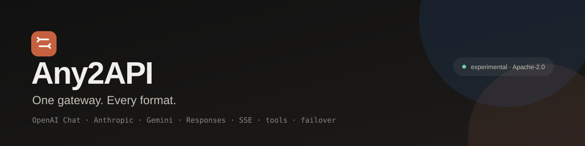
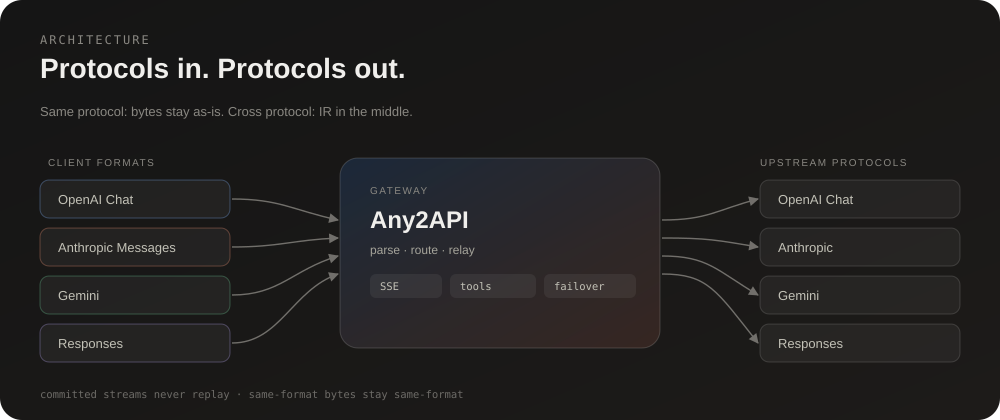
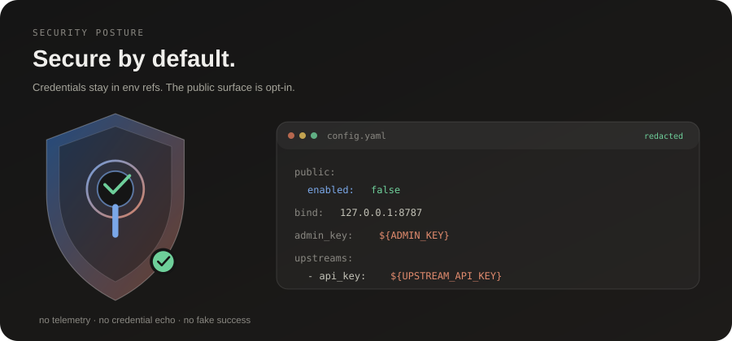

<p align="center"></p>

# Any2API

**Website: [dwgx.github.io/any2api](https://dwgx.github.io/any2api/) ・ [繁體中文](README.zh-Hant.md) ・ [繁中頁面](https://dwgx.github.io/any2api/zh-Hant/)**

Universal protocol transport translator for LLM APIs: one service that accepts OpenAI Chat, Anthropic Messages, Gemini, and OpenAI Responses requests, converts them to the configured upstream protocol, and converts responses back — including streaming, tool calls, and failover.

**Status: experimental.** Verify the terms of every upstream provider before deploying. The public service surface is disabled by default; keep it disabled unless you have reviewed the legal and operational requirements.

## Features

- Entry formats: OpenAI Chat Completions, Anthropic Messages, Gemini `generateContent`, OpenAI Responses.
- Upstream protocols: OpenAI Chat, Anthropic Messages, Gemini, Responses, plus optional web-compatible adapters.
- Streaming SSE with terminal-frame validation, cancellation handling, and first-byte/idle guards.
- Tool calls and tool-name hygiene across formats.
- Ordered failover, cooldowns, retry-after handling, and per-exception budgets.
- Optional admin surface: diagnostics, request ring, metrics, audit, model usage.
- Optional managed background tasks for Responses.
- Optional public service surface (sessions, access keys, rate limits, concurrency gate) — **off by default**.
- No telemetry. No credentials in this repository.

## Architecture



## Quick start

Requirements: Go 1.26+.

```bash
cd src
go build -o any2api ./cmd/any2api
cp config.example.yaml ../config.yaml
# edit ../config.yaml: upstream base_url, model names, and credentials
../any2api -config ../config.yaml
```

The service listens on `127.0.0.1:8787` by default.

```bash
curl -s http://127.0.0.1:8787/healthz
curl -s http://127.0.0.1:8787/v1/models
```

### Docker

```bash
cp src/config.example.yaml config.yaml
# edit config.yaml
docker compose up -d --build
```

The compose file mounts `config.yaml` read-only and keeps data in a named volume.

## Configuration

See [`src/config.example.yaml`](src/config.example.yaml) and [`docs/configuration.md`](docs/configuration.md).

Credentials can use environment references:

```yaml
upstreams:
  - name: primary
    protocol: openai_chat
    base_url: "https://api.example.com/v1"
    api_key: "${UPSTREAM_API_KEY}"
```

`config.yaml`, `.env*`, `data/`, and generated databases are ignored by git. Do not commit real credentials.

## Security and privacy

- This repository contains **no accounts, cookies, API keys, or deployment credentials**. Test fixtures use fake values.
- Keep secrets in environment variables or a local, untracked `config.yaml` with restrictive permissions.
- The admin surface is disabled when `admin_key` is unset; bind the service to loopback unless you put a reviewed reverse proxy in front.
- `public.enabled` is `false` by default. Enabling it turns on sessions, access keys, per-IP limits, concurrency limits, and budget controls.
- See [`SECURITY.md`](SECURITY.md) for reporting and hardening notes.



## 繁體中文

Any2API 是 LLM API 的通用協定傳輸層：同一個服務接受 OpenAI Chat、Anthropic Messages、Gemini 與 Responses，轉換成設定的上游協定，再把回應轉回來，涵蓋串流、工具呼叫與容錯切換。完整說明請見 **[README.zh-Hant.md](README.zh-Hant.md)**，或直接前往 **[繁體中文頁面](https://dwgx.github.io/any2api/zh-Hant/)**。

## Documentation

- [Architecture](docs/architecture.md)
- [Configuration](docs/configuration.md)
- [Deployment](docs/deployment.md)
- [Service API and operations](docs/service.md)

## Tests

```bash
cd src
go test ./... -count=1
go vet ./...
```

## License

Apache License 2.0. See [`LICENSE`](LICENSE).
