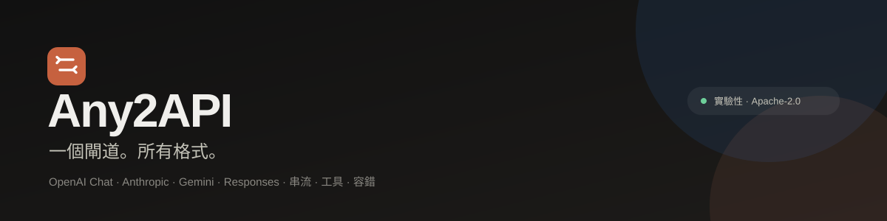
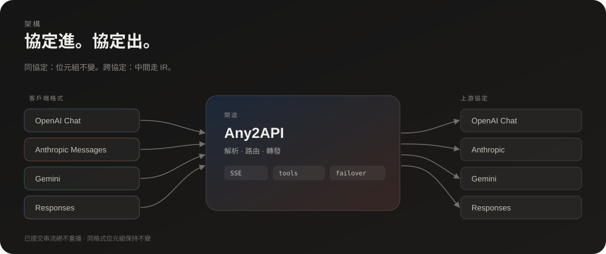
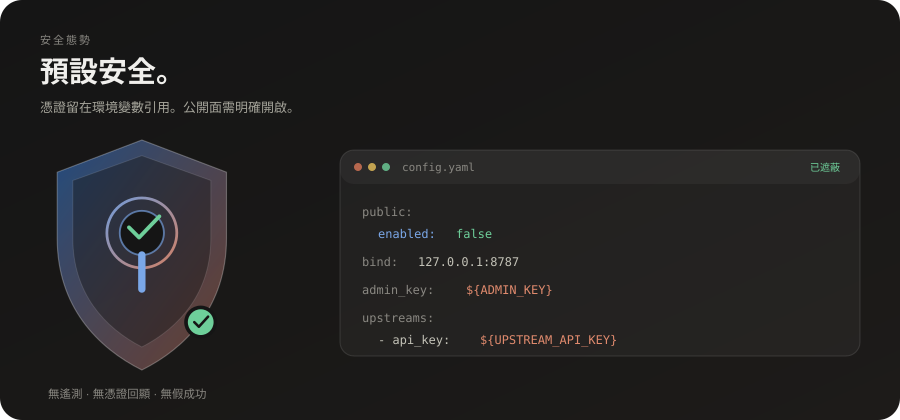

<p align="center"></p>

# Any2API

**網站：[dwgx.github.io/any2api](https://dwgx.github.io/any2api/) ・ [繁體中文頁面](https://dwgx.github.io/any2api/zh-Hant/)**

**語言：[English](README.md) ・ 繁體中文**

LLM API 的通用協定傳輸轉換器：一個服務接受 OpenAI Chat、Anthropic Messages、Gemini 與 OpenAI Responses 請求，轉換成設定的上游協定，再把回應轉回來——包含串流、工具呼叫與容錯切換。

**狀態：實驗性。** 部署前請確認每個上游供應商的條款。公開服務面預設關閉；除非已審查法律與營運要求，否則請保持關閉。

## 功能

- 入口格式：OpenAI Chat Completions、Anthropic Messages、Gemini `generateContent`、OpenAI Responses。
- 上游協定：OpenAI Chat、Anthropic Messages、Gemini、Responses，以及可選的網頁相容轉接器。
- SSE 串流，含終端幀驗證、取消處理、首字與閒置守衛。
- 跨格式的工具呼叫與工具名稱正規化。
- 有序容錯、冷卻、retry-after 處理與逐例外預算。
- 可選管理面：診斷、請求環、指標、審計、模型用量。
- 可選的 Responses 託管背景任務。
- 可選公開服務面（工作階段、access key、速率限制、併發閘門）——**預設關閉**。
- 無遙測。本倉庫不含憑證。

## 架構



## 快速開始

需求：Go 1.26+。

```bash
cd src
go build -o any2api ./cmd/any2api
cp config.example.yaml ../config.yaml
# 編輯 ../config.yaml：上游 base_url、模型名稱與憑證
../any2api -config ../config.yaml
```

服務預設監聽 `127.0.0.1:8787`。

```bash
curl -s http://127.0.0.1:8787/healthz
curl -s http://127.0.0.1:8787/v1/models
```

### Docker

```bash
cp src/config.example.yaml config.yaml
# 編輯 config.yaml
docker compose up -d --build
```

Compose 檔以唯讀方式掛載 `config.yaml`，資料放在具名 volume。

## 設定

見 [`src/config.example.yaml`](src/config.example.yaml) 與 [`docs/configuration.md`](docs/configuration.md)。

憑證可使用環境變數引用：

```yaml
upstreams:
  - name: primary
    protocol: openai_chat
    base_url: "https://api.example.com/v1"
    api_key: "${UPSTREAM_API_KEY}"
```

`config.yaml`、`.env*`、`data/` 與產生的資料庫已被 git 忽略。請勿提交真實憑證。

## 安全與隱私

- 本倉庫**不含帳號、cookie、API 金鑰或部署憑證**。測試 fixture 使用假值。
- 將密鑰放在環境變數，或權限受限、未跟蹤的本機 `config.yaml`。
- 未設定 `admin_key` 時管理面關閉；除非前面有審查過的反向代理，否則請將服務綁定 loopback。
- `public.enabled` 預設為 `false`。啟用後會開啟工作階段、access key、per-IP 限制、併發限制與預算控制。
- 回報與加固說明見 [`SECURITY.md`](SECURITY.md)。



## 文件

- [架構](docs/architecture.md)
- [設定](docs/configuration.md)
- [部署](docs/deployment.md)
- [服務 API 與運維](docs/service.md)

## 測試

```bash
cd src
go test ./... -count=1
go vet ./...
```

## 授權

Apache License 2.0。見 [`LICENSE`](LICENSE)。
